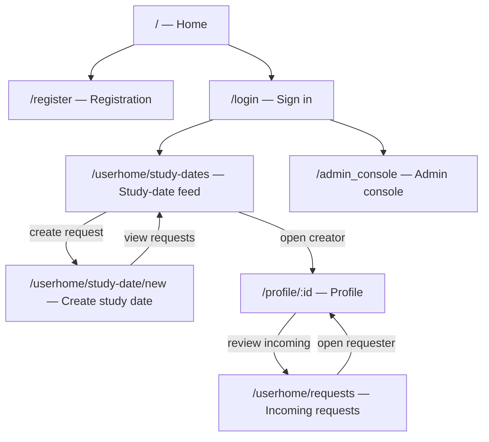

# Traceability

## Business rules

Numbered, so issues and tests can cite them.

| #   | Rule                           | example                                                     |
| --- | ------------------------------ | ----------------------------------------------------------- |
| BR1 | Minimum User Age 18            | Registration is rejected.                                   |
| BR2 | Profile Completion Requirement | The profile is incomplete and must not appear in discovery. |
| BR3 | Mutual Match Requirement       | Alex likes Jordan. Jordan does not like Alex. -> no match   |
| BR4 | One Decision Per Profile       | Alex selects Like for Jordan again -> ignored               |
| BR5 | Message Length Limit           | A message must contain between 1 and 500 characters.        |
| BR6 | Blocked Users Cannot Interact  |                                                             |

## Current story/status matrix

Statuses reflect implementation and checked-in evidence. `Partial` means a
working slice exists but acceptance or verification remains incomplete.

| Story | Route | Status | Implementation and evidence |
|---|---|---|---|
| US01 — Register with NEU email | `/register` | Partial | [Registration handler](../src/ss/register.rs) stores a password hash. Microsoft verification is required before password login; no dedicated registration browser test is checked in. |
| US02 — Create a study date request | `/userhome/study-date/new` | Partial | [Study-date handler](../src/ss/study_date.rs) has validation and handler tests; browser flow is not covered. |
| US03 — Browse active study date requests | `/userhome/study-dates` | Partial | [Study-date handler](../src/ss/study_date.rs) checks active-window filtering and ordering; browser flow and empty/error states are not covered. |
| US04 — Send a match request | `/profile/:id` | Partial | [Matching handler](../src/ss/matching.rs) checks profile relation states, verified-profile filtering, and self-request rejection; end-to-end browser flow is not covered. |
| US05 — Accept or decline a match request | `/userhome/requests` | Partial | [Matching handler](../src/ss/matching.rs) has accept/decline tests; end-to-end browser flow is not covered. |
| US12 — Restrict admin console to admins | `/admin_console` | Partial | Anonymous denial is checked against a running app and admin access by database-backed tests; regular-user denial remains open. See [testing.md](testing.md). |
| US13 — View database and server health | Health API | Partial | Healthy endpoint and independent health-component states are tested; the database-failure HTTP path remains open. See [testing.md](testing.md). |
| US14 — View admin dashboard statistics | `/admin_console` | Partial | Database-backed counts and zero/error response models are tested; HTTP/UI failure and refresh behavior remain open. See [testing.md](testing.md). |

Registration does not use OTP. Users register with a unique username, NEU
email, and password; Microsoft sign-in verifies the NEU address, after which
password login is allowed. Login and logout routes are `/login` and `/logout`.

## P0 evidence

SVGs are wireframes, not screenshots of the running application. Runtime
screenshots are not checked in; manual capture requirements are listed in the
[Sprint 3 review checklist](./log/sprint-3-review-evidence.md).

| Story | Code | Automated evidence | Remaining gap | Design evidence |
|---|---|---|---|---|
| US01 — Register | [register handler](../src/ss/register.rs), [registration page](../src/app/register.rs) | No dedicated registration test found | Verify Microsoft flow and capture browser journey. | [register.svg](./images/ui/register.svg) |
| US02 — Create study date | [study-date handler](../src/ss/study_date.rs), [form](../src/app/userhome/study_date_form.rs) | Validation and handler tests | Browser flow. | [study-date-form.svg](./images/ui/study-date-form.svg) |
| US03 — Browse study dates | [study-date handler](../src/ss/study_date.rs), [feed](../src/app/userhome/study_feed.rs) | Active-window and ordering query checks | Browser flow and empty/error states. | [study-feed.svg](./images/ui/study-feed.svg) |
| US04 — Send match request | [matching handler](../src/ss/matching.rs), [profile](../src/app/profile.rs) | Profile relation and self-request checks | Profile-to-request browser flow. | [profile.svg](./images/ui/profile.svg) |
| US05 — Review match request | [matching handler](../src/ss/matching.rs), [requests page](../src/app/userhome/requests.rs) | Accept/decline handler tests | Incoming-request browser flow. | [requests.svg](./images/ui/requests.svg) |
| US12 — Admin access | [auth handler](../src/ss/auth.rs), [admin page](../src/app/admin.rs) | Anonymous API denial is checked against a running app; database-backed admin requests verify admin success. | Regular-user `403` and browser role states; follow-up [issue #95](https://github.com/SE-FDA-NEU-AI66B/G8-DatingApp-AI66B/issues/95). | [admin-console.svg](./images/ui/admin-console.svg) |
| US13 — Health status | [admin handler](../src/ss/admin.rs) | PostgreSQL integration checks both healthy components; a response-model test checks an unhealthy database with a healthy server. | Exercise database failure through the health endpoint; follow-up [issue #95](https://github.com/SE-FDA-NEU-AI66B/G8-DatingApp-AI66B/issues/95). | — |
| US14 — Dashboard statistics | [admin handler](../src/ss/admin.rs), [admin page](../src/app/admin.rs) | PostgreSQL integration checks real count increments; response-model tests cover zero counts and an error message. | Exercise HTTP/UI error and refresh states; follow-up [issue #95](https://github.com/SE-FDA-NEU-AI66B/G8-DatingApp-AI66B/issues/95). | [admin-console.svg](./images/ui/admin-console.svg) |

## P0 screens and flow

Routes below are registered in `src/app/mod.rs`. The admin console is protected
by authentication and an admin-role gate.

Additional registered routes include `/userhome`, `/userhome/explore`,
`/userhome/chat`, `/userhome/chat/:id`, `/user_profile`, and `/logout`. The
flow diagram focuses on the stories traced above.
