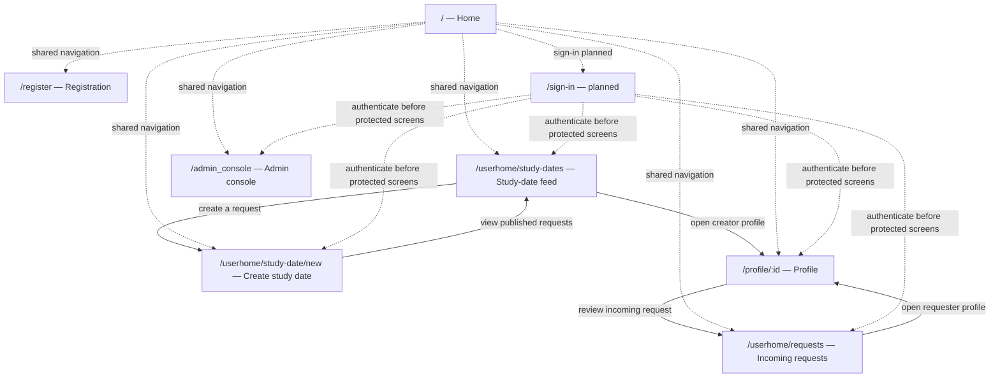

# Traceability

## Business rules

Numbered, so issues and tests can cite them.

| #   | Rule                           | example                                                     |
| --- | ------------------------------ | ----------------------------------------------------------- |
| BR1 | Minimum User Age 18            | Registration is rejected.                                   |
| BR2 | Profile Completion Requirement | The profile is incomplete and must not appear in discovery. |
| BR3 | Mutual Match Requirement       | Alex likes Jordan. Jordan does not like Alex. -> no match   |
| BR4 | One Decision Per Profile       | Alex selects Like for Jordan again -> ignored               |
| BR5 | Message Length Limit           | A message must contain between 1 and 500 characters.        |
| BR6 | Blocked Users Cannot Interact  |                                                             |

## Milestone 3: P0 story/status matrix

The statuses below reflect the implementation and tests currently present in
the repository. `partly works` means there is a working slice but at least one
acceptance item or end-to-end verification remains incomplete. The P0 browser
coverage issue is still open.

| Story | Screen(s) | Route | Status | Issue |
|---|---|---|---|---|
| US01 — Register with NEU email | Registration | `/register` | partly works | Implementation: [#58](https://github.com/SE-FDA-NEU-AI66B/G8-DatingApp-AI66B/issues/58); tests: [#95](https://github.com/SE-FDA-NEU-AI66B/G8-DatingApp-AI66B/issues/95) |
| US02 — Create a study date request | Create study date | `/userhome/study-date/new` | works | Implementation: [#57](https://github.com/SE-FDA-NEU-AI66B/G8-DatingApp-AI66B/issues/57); tests: [#95](https://github.com/SE-FDA-NEU-AI66B/G8-DatingApp-AI66B/issues/95) |
| US03 — Browse active study date requests | Study dates | `/userhome/study-dates` | works | Implementation: [#56](https://github.com/SE-FDA-NEU-AI66B/G8-DatingApp-AI66B/issues/56); tests: [#95](https://github.com/SE-FDA-NEU-AI66B/G8-DatingApp-AI66B/issues/95) |
| US04 — Send a match request | Profile | `/profile/:id` | partly works | Implementation: [#59](https://github.com/SE-FDA-NEU-AI66B/G8-DatingApp-AI66B/issues/59); tests: [#95](https://github.com/SE-FDA-NEU-AI66B/G8-DatingApp-AI66B/issues/95) |
| US05 — Accept or decline a match request | Incoming requests | `/userhome/requests` | partly works | Implementation: [#60](https://github.com/SE-FDA-NEU-AI66B/G8-DatingApp-AI66B/issues/60); tests: [#95](https://github.com/SE-FDA-NEU-AI66B/G8-DatingApp-AI66B/issues/95) |
| US12 — Restrict admin console to admins | Admin console | `/admin_console` | partly works | Implementation: [#67](https://github.com/SE-FDA-NEU-AI66B/G8-DatingApp-AI66B/issues/67), [#76](https://github.com/SE-FDA-NEU-AI66B/G8-DatingApp-AI66B/issues/76); tests: [#95](https://github.com/SE-FDA-NEU-AI66B/G8-DatingApp-AI66B/issues/95) |
| US13 — View database and server status | Admin console health | `/admin_console` | partly works | Implementation: [#68](https://github.com/SE-FDA-NEU-AI66B/G8-DatingApp-AI66B/issues/68); tests: [#95](https://github.com/SE-FDA-NEU-AI66B/G8-DatingApp-AI66B/issues/95) |

                                            ┌─────────────┐
                                            │      /      │
                                            └──────┬──────┘
                                                   │ sign in
                                                   ▼
                 ┌─────────────────┐if admin┌─────────────────┐    ┌─────────────────┐    ┌────────────┐
                 │  /admin_console │────────│   /user_home     │────│  /user_profile  │────│   /chat    │
                 └─────────────────┘        └─────────────────┘    └─────────────────┘    └────────────┘
US01 is partial because the generated OTP is currently written to the
development server log rather than delivered by an email provider, and there
is no sign-in screen. US04, US05, US12, and US13 are marked partial until the
full P0 browser flow is covered by the open
[#95](https://github.com/SE-FDA-NEU-AI66B/G8-DatingApp-AI66B/issues/95).

## P0 evidence

The SVG links are wireframe evidence, not screenshots of the running app. No
runtime screenshots for these stories are currently checked into the
documentation; capture them when the corresponding browser flows are tested.

| Story | Code | Test evidence | Gap | Screenshot evidence | Implementation / test issue |
|---|---|---|---|---|---|
| US01 — Register | [src/ss/register.rs](../src/ss/register.rs), [src/app/register.ss](../src/app/register.ss) | No story-specific automated test found; tracked by [#95](https://github.com/SE-FDA-NEU-AI66B/G8-DatingApp-AI66B/issues/95) | OTP is printed to the server log, not delivered by email; sign-in screen is absent. | [register.svg](./images/ui/register.svg) (wireframe; runtime screenshot missing) | [#58](https://github.com/SE-FDA-NEU-AI66B/G8-DatingApp-AI66B/issues/58), [#95](https://github.com/SE-FDA-NEU-AI66B/G8-DatingApp-AI66B/issues/95) |
| US02 — Create study date | [src/ss/study_date.rs](../src/ss/study_date.rs), [src/app/study_date_form.rs](../src/app/study_date_form.rs) | [src/ss/study_date.rs](../src/ss/study_date.rs) (validation and handler tests) | Browser flow is not covered by the current Playwright suite. | [study-date-form.svg](./images/ui/study-date-form.svg) (wireframe; runtime screenshot missing) | [#57](https://github.com/SE-FDA-NEU-AI66B/G8-DatingApp-AI66B/issues/57), [#95](https://github.com/SE-FDA-NEU-AI66B/G8-DatingApp-AI66B/issues/95) |
| US03 — Browse study dates | [src/ss/study_date.rs](../src/ss/study_date.rs), [src/app/study_feed.rs](../src/app/study_feed.rs) | [src/ss/study_date.rs](../src/ss/study_date.rs) (feed query test) | Browser flow and empty/error states are not covered by the current Playwright suite. | [study-feed.svg](./images/ui/study-feed.svg) (wireframe; runtime screenshot missing) | [#56](https://github.com/SE-FDA-NEU-AI66B/G8-DatingApp-AI66B/issues/56), [#95](https://github.com/SE-FDA-NEU-AI66B/G8-DatingApp-AI66B/issues/95) |
| US04 — Send match request | [src/ss/matching.rs](../src/ss/matching.rs), [src/app/profile.rs](../src/app/profile.rs) | [src/ss/matching.rs](../src/ss/matching.rs) (matching handler tests) | Full profile-to-request browser flow is not covered by Playwright. | [profile.svg](./images/ui/profile.svg) (wireframe; runtime screenshot missing) | [#59](https://github.com/SE-FDA-NEU-AI66B/G8-DatingApp-AI66B/issues/59), [#95](https://github.com/SE-FDA-NEU-AI66B/G8-DatingApp-AI66B/issues/95) |
| US05 — Review match request | [src/ss/matching.rs](../src/ss/matching.rs), [src/app/requests.rs](../src/app/requests.rs) | [src/ss/matching.rs](../src/ss/matching.rs) (accept/decline handler tests) | Full incoming-request browser flow is not covered by Playwright. | [requests.svg](./images/ui/requests.svg) (wireframe; runtime screenshot missing) | [#60](https://github.com/SE-FDA-NEU-AI66B/G8-DatingApp-AI66B/issues/60), [#95](https://github.com/SE-FDA-NEU-AI66B/G8-DatingApp-AI66B/issues/95) |
| US12 — Admin access | [src/ss/admin.rs](../src/ss/admin.rs), [src/ss/auth.rs](../src/ss/auth.rs), [src/app/admin.rs](../src/app/admin.rs) | [admin-dashboard.spec.ts](../end2end/tests/admin-dashboard.spec.ts) covers dashboard load/error, not the full authorization matrix. | Browser tests for anonymous, regular-user, and admin access are incomplete. | [admin-console.svg](./images/ui/admin-console.svg) (wireframe; runtime screenshot missing) | [#67](https://github.com/SE-FDA-NEU-AI66B/G8-DatingApp-AI66B/issues/67), [#76](https://github.com/SE-FDA-NEU-AI66B/G8-DatingApp-AI66B/issues/76), [#95](https://github.com/SE-FDA-NEU-AI66B/G8-DatingApp-AI66B/issues/95) |
| US13 — View server/database health | [src/ss/admin.rs](../src/ss/admin.rs), [src/app/admin.rs](../src/app/admin.rs) | [admin-dashboard.spec.ts](../end2end/tests/admin-dashboard.spec.ts) does not assert health states. | Browser verification of independent server/database health and failure states is missing. | [admin-console.svg](./images/ui/admin-console.svg) (wireframe; runtime screenshot missing) | [#68](https://github.com/SE-FDA-NEU-AI66B/G8-DatingApp-AI66B/issues/68), [#95](https://github.com/SE-FDA-NEU-AI66B/G8-DatingApp-AI66B/issues/95) |

## P0 screens and flow

All seven P0 routes are registered in `src/app/mod.rs`. Solid arrows below
are in-screen links/actions found in the code. Dashed arrows represent the
shared navigation-bar destinations and the proposed sign-in flow; `/sign-in`
is not implemented yet. The root route is registered but currently renders
the Leptos demo rather than the designed P0 home screen.

The currently registered P0 routes are `/`, `/register`, `/userhome/study-dates`,
`/userhome/study-date/new`, `/profile/:id`, `/userhome/requests`, and `/admin_console`. No
`/user_profile`, `/user_home`, or `/chat` route is included in this P0 flow;
chat remains outside P0.
>>>>>>> origin/main
