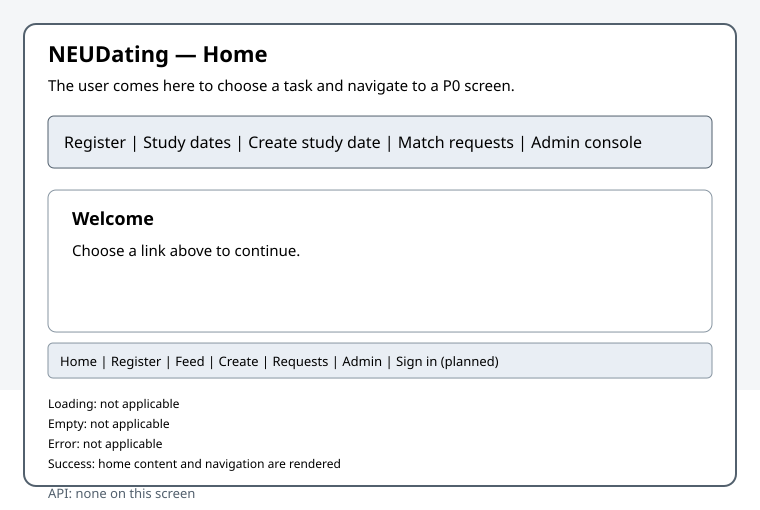
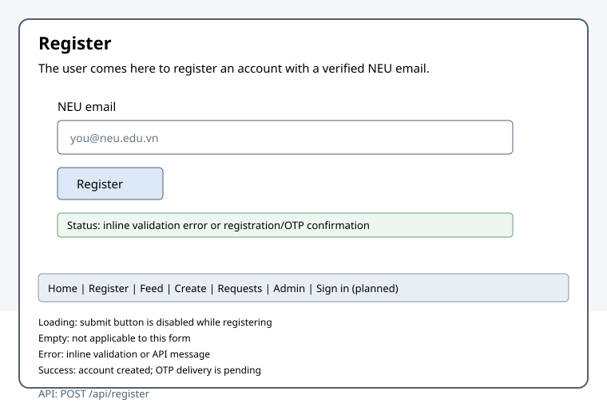
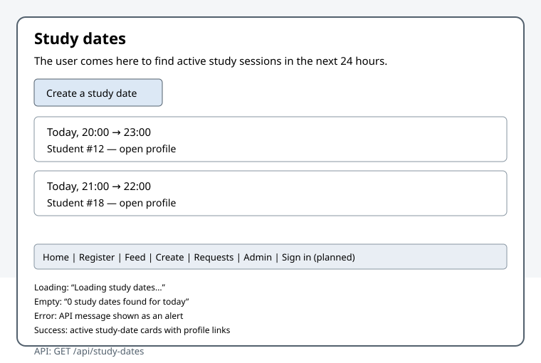
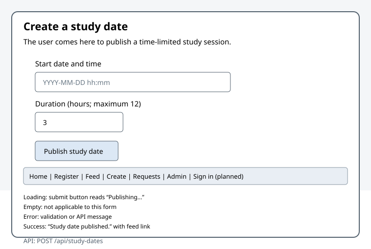
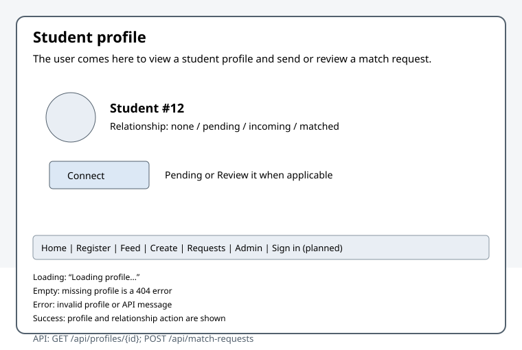
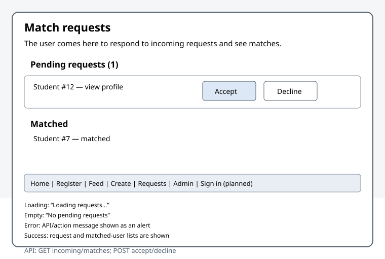
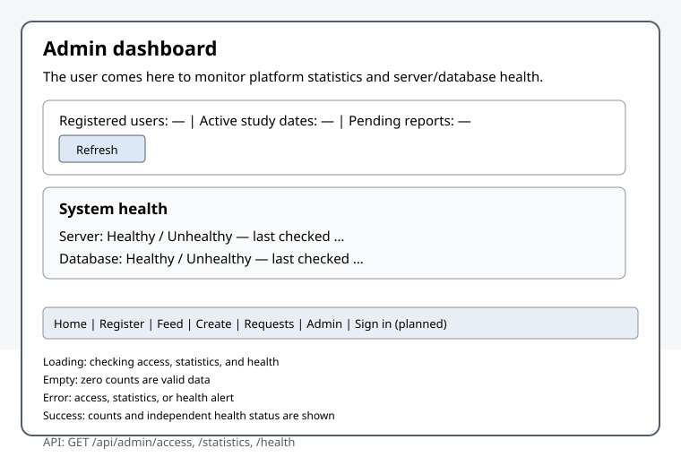

# Milestone 3 UI

## 1. P0 status

Status reflects the current implementation. `partly works` identifies a
working slice with a known gap; `works` means the screen and its implemented
behavior are present. The full P0 browser-flow coverage remains open in
[issue #95](https://github.com/SE-FDA-NEU-AI66B/G8-DatingApp-AI66B/issues/95).
For the story-level matrix and reachable-screen flow, see
[traceability](./traceability.md#milestone-3-p0-storystatus-matrix).

| P0 screen / story | Route | Status | Endpoints |
|---|---|---|---|
| Home and navigation | `/` | works | None |
| Register with NEU email (US01) | `/register` | partly works | `POST /api/register` |
| Browse active study dates (US03) | `/feed` | works | `GET /api/study-dates` |
| Create a study date (US02) | `/study-date/new` | works | `POST /api/study-dates` |
| View profile / send match request (US04) | `/profile/:id` | partly works | `GET /api/profiles/{id}`, `POST /api/match-requests` |
| Accept or decline incoming request (US05) | `/requests` | partly works | `GET /api/match-requests/incoming`, `GET /api/matches`, `POST /api/match-requests/{id}/accept`, `POST /api/match-requests/{id}/decline` |
| Admin console access (US12), dashboard flow, health (US13) | `/admin_console` | partly works | `GET /api/admin/access`, `GET /api/admin/statistics`, `GET /api/admin/health` |

US01 stores a generated OTP and currently prints it to the development server
log instead of delivering it through an email provider. The admin dashboard
implements access checks, statistics, and separate server/database health,
but complete browser-flow verification is still tracked by issue #95. Protected
routes and endpoints require an authenticated session; an administrator is
required for `/admin_console`.

## 2. Wireframes

The wireframes below cover each P0 screen. Each states the user's goal and
lists the API endpoints called by that screen; the home/navigation screen
does not call an API.

### Home and navigation — `/`

The user comes here to choose a task and navigate to any P0 screen.

API endpoints: none.

### Registration — `/register`

The user comes here to create an account with a verified NEU email address.

API endpoints: `POST /api/register`.

### Study-date feed — `/feed`

The user comes here to browse active study dates and open a creator's profile.

API endpoints: `GET /api/study-dates`.

### Create study date — `/study-date/new`

The user comes here to publish a study date with a start time and duration.

API endpoints: `POST /api/study-dates`.

### Profile — `/profile/:id`

The user comes here from a feed card or incoming request to view a profile and
send a match request, or review an incoming one.

API endpoints: `GET /api/profiles/{id}`, `POST /api/match-requests`.

### Incoming requests — `/requests`

The user comes here to accept or decline incoming match requests and see
matched users.

API endpoints: `GET /api/match-requests/incoming`, `GET /api/matches`,
`POST /api/match-requests/{id}/accept`,
`POST /api/match-requests/{id}/decline`.

### Admin console — `/admin_console`

The administrator comes here to review platform statistics and separate
server/database health indicators.

API endpoints: `GET /api/admin/access`, `GET /api/admin/statistics`,
`GET /api/admin/health`.

### Four UI states

The standard states are loading, empty, error, and populated/success. “Not
applicable” means the screen does not load a collection or has no separate
empty state in the current implementation; it is not an implemented screen
state.

| Screen | Loading | Empty | Error | Populated / success |
|---|---|---|---|---|
| Home | Not applicable | Not applicable | Not applicable | Navigation and home content are rendered |
| Registration | Submit button is disabled while registering | Not applicable (form) | Inline validation or API message | Account creation confirmation; OTP is currently printed to the development server log rather than emailed |
| Study-date feed | “Loading study dates...” | “0 study dates found for today” | API message shown as an alert | Active study-date cards; creator links open profiles |
| Create study date | Submit button reads “Publishing...” during submission | Not applicable (form) | Validation or API message shown as an alert | “Study date published.” with a link to the feed |
| Profile | “Loading profile...” | No separate empty state; a missing profile is an API error | Invalid profile or API message shown as an alert | Profile and relationship action: Connect, Pending, Review it, Matched, or self profile |
| Incoming requests | “Loading requests...” | “No pending requests” | API/action message shown as an alert | Incoming request rows and matched-user list; accept/decline updates the lists |
| Admin console | “Checking administrator access...”, then statistics/health loading | Zero counts are valid data; no separate empty state | Access, statistics, or health error shown as an alert | Three statistics, separate server/database status and checked-at timestamps |

## 3. Error messages

The messages below are the exact user-facing strings returned or displayed by
the current implementation. They identify what happened and the suggested
next step; server-side diagnostic details stay in server logs.

| Screen / endpoint | HTTP status | Headline (exact server message) | Hint |
|---|---:|---|---|
| Registration — `POST /api/register` | 400 | `Please use a valid @neu.edu.vn email address` | Use a valid NEU email address ending in `@neu.edu.vn`, then submit again. |
| Match request — `POST /api/match-requests` | 400 | `You cannot send a request to yourself` | Choose another profile; a user cannot send a match request to their own account. |
| Login — `POST /api/auth/login`; protected user/admin endpoints | 401 | `Invalid email or OTP.`; `Authentication is required.` | Check the email and current OTP, or sign in to create a valid session before retrying. There is currently no sign-in screen. |
| Admin endpoint or match-request decision — `GET /api/admin/*`, `POST /api/match-requests/{id}/accept` or `/decline` | 403 | `Administrator access is required.`; `You are not the recipient of this request` | Use an administrator account for admin routes. Only the intended recipient can accept or decline a match request. |
| Profile or match request — `GET /api/profiles/{id}` or `POST /api/match-requests` | 404 | `Profile not found` | The profile is unavailable or not verified; return to the feed and choose another profile. |
| Registration — `POST /api/register` | 409 | `This email is already registered` | Use the existing account and sign in instead of registering again. |
| Match request — `POST /api/match-requests` | 409 | `Request already sent`; `This user has already sent you a request` | Review the existing relationship or incoming request instead of submitting a duplicate. |
| Registration, study-date, match-request, or admin-statistics endpoint | 500 | `Something went wrong, please try again`; `Dashboard statistics are temporarily unavailable.` | Retry the action. If the error continues, report the affected screen and time to the team; diagnostic details are kept in server logs. |
| Study-date creation — `POST /api/study-dates` | 422 (new after M2) | `Maximum study date duration is 12 hours`; `Study date duration must be at least 1 minute`; `Choose a valid start date and time` | Choose a valid local start time and a duration from 1 minute through 12 hours. |
| Match request — `POST /api/match-requests` | 429 (new after M2) | `Daily limit of 20 requests reached` | The daily request limit has been reached; try again tomorrow. |

### Replace generic UI fallbacks

These are proposed UI copy replacements for generic client-side failures. They
do not change the exact server headlines above.

| Current generic text | Screen-specific replacement |
|---|---|
| `Something went wrong, please try again` | Registration: “We could not create your account. Check the email address and try again.” Study dates: “We could not load or publish this study date. Try again.” Match requests: “We could not update this request. Refresh the profile or request list and try again.” |
| `Unexpected server response` | “The server returned an unreadable response. Try again; if it continues, report this screen and time.” |
| `Request failed (<status>)` | “The request could not be completed (HTTP <status>). Check the form or your access, then try again.” |

## 4. Changes since M2

- M2's walking skeleton centered on an authenticated admin dashboard with
  database-backed statistics, a health endpoint, and browser/test
  infrastructure. M3 extends the UI to P0 student workflows: NEU email
  registration, study-date creation and browsing, profile connections, and
  incoming-request decisions.
- Added and reconciled the P0 route inventory and end-to-end screen flow;
  shared navigation exposes the registered P0 entry points.
- Expanded the admin UI to show authorization feedback, loading/data/error
  behavior, refresh, and independent server/database health with timestamps.
- Added per-screen wireframes, endpoint mappings, and the four-state inventory
  in this document. M3 implementation and documentation tracking is recorded
  in issues [#88](https://github.com/SE-FDA-NEU-AI66B/G8-DatingApp-AI66B/issues/88),
  [#89](https://github.com/SE-FDA-NEU-AI66B/G8-DatingApp-AI66B/issues/89), and
  [#90](https://github.com/SE-FDA-NEU-AI66B/G8-DatingApp-AI66B/issues/90).
- Added study-date validation `422` and match-request rate-limit `429` after
  M2; both are identified as new statuses in the error table.
- Reconciled the documented auth endpoints with the current handlers:
  registration is `POST /api/register`, login is `POST /api/auth/login`, and
  logout is `POST /api/auth/logout`. The code still has no sign-in screen, and
  registration OTP delivery is a server-log stub.
- The dashboard currently starts statistics and health fetches separately;
  `fetch_health` is not nested inside `fetch_statistics`. The root route still
  renders the Leptos demo components, so the P0 home design is not yet the
  implemented root experience.
